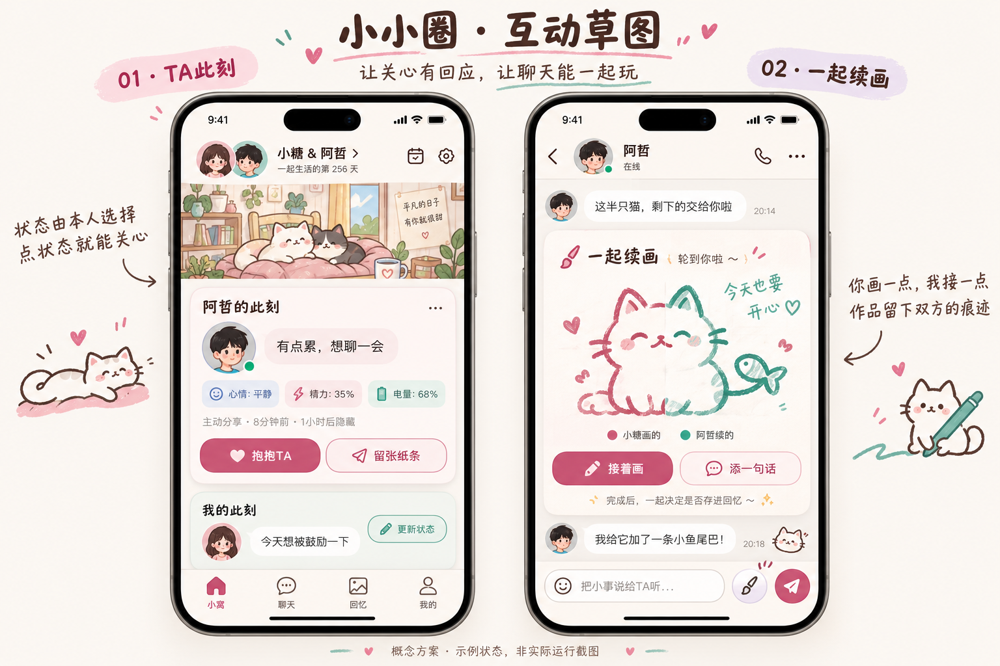

# 小小圈：下一轮互动概念

以下是概念草图，状态数值均为示例，并非实际运行截图。这两个方向尚未实装；现有项目仍是本机体验版。

## 首页：TA此刻

保留共同小窝作为视觉中心，在它下面放一张可以回应的状态卡。内容来自本人主动选择，不用系统猜测心情。

- 心情：开心、平静、有点累、低落，附一句自己的话。
- 精力：充足、一般、想休息。
- 忙闲与陪伴需求：正在忙、可以聊聊、想被鼓励、想安静一会。
- 电量作为辅助信息，由本人选择是否分享。尚未分享时显示“暂未分享”，不填入示例数值。
- 显示分享时间，允许选一小时等期限后隐藏，随时停止分享。
- 对方可以点“抱抱TA”或“留张纸条”，直接进入对应聊天互动。

闺蜜空间用同样的卡片展示成员主动分享的状态；没有分享的人不显示推测状态。真实电量与对方状态的展示，需要账号、空间权限、授权与双机同步。

## 聊天：一起续画

把现有单人绘图延伸为“你画一点，我接一点”。

1. 从聊天发起一张画布，画半只猫、一个开头或手写一句话。
2. 对方接住邀请，沿用画布添画、手写或加一句话；自己的新笔画用另一种颜色标识。
3. 交回对方，可以继续几轮，也可以结束。每轮保留署名和顺序，避免同时改画布互相覆盖。
4. 完成后，双方选择是否保存到共同回忆；画布仍能在原聊天卡片中查看。

第一版以轮流续画为主。真正跨设备协作需要传输画布、笔画或版本，并处理离线、重复提交与轮次冲突；不把本机操作展示为对方正在绘画。

## 其他值得尝试的玩法

| 玩法 | 一次互动怎样发生 | 留下什么 |
| --- | --- | --- |
| 双人盲画 | 两人收到同一道题，各画30秒，提交后一起揭晓；也可以给彼此出题 | 两张并排的小画，自己决定是否收藏 |
| 声音藏宝盒 | 录三条很短的声音线索，让对方猜今天的小惊喜、共同回忆或下次约会安排 | 猜完后的回应和一张声音卡 |
| 今日心意交换 | 各自选一件“今天想为你做的小事”，两人都选完再揭晓；可以跳过或修改 | 一次具体的关心，不计输赢或连续天数 |
| 小窝演一幕 | 从聊天挑一个自愿分享的小片段，双方添一句台词、一个表情或手绘物件 | 一张两人共同写的小剧场卡 |

优先顺序建议：先让“此刻状态”能引发回应，再做轮流续画，随后挑一个盲画或声音小游戏验证长期是否好玩。保留普通聊天入口，互动由用户发起，不强制每日完成。
